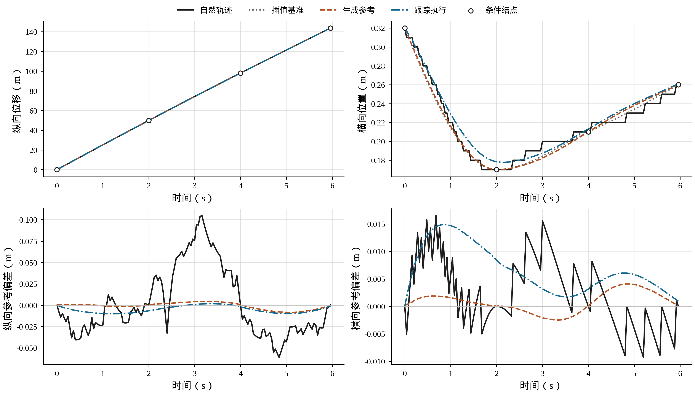

# 发明专利技术交底书

| 项目 | 内容 |
| --- | --- |
| 专利名称 | 一种基于交互失效邻域反馈的自动驾驶迭代测试方法 |
| 技术领域 | 自动驾驶闭环仿真测试与测试资源调度 |
| 申请人 | 待填写 |
| 发明人 | 待确认合并方案的贡献人员、姓名及顺序 |
| 交底书撰写人 | 蒋拯民 |
| 技术联系人及联系方式 | 待填写 |
| 文稿日期 | 2026年10月25日；整合讨论稿 |

## 1 技术领域与技术问题

本发明涉及自动驾驶系统的闭环仿真测试，具体涉及一种利用交通交互中的局部失效及其成功邻点，联合确定后续测试条件与执行资源的方法。测试设备恢复道路、参与车辆和初始运动条件，由被测驾驶策略控制主车，背景车辆根据实际交通状态调整行为；通过局部行为变化发现失效，并在驾驶策略更新后恢复相同外部输入，检查原失效是否解除以及邻近成功条件是否出现回归，再据此安排下一轮测试。

驾驶策略的制动、加速和转向会改变背景车辆的响应，实际危险过程由多车连续交互形成。直接重放原始轨迹，难以反映策略改变后的交通后果；同时改变初始交通条件与多类背景行为，又难以确定下一次应当优先调整的行为。即使已经发现失效，只保存碰撞实例也不能充分利用其邻近、曾经成功的条件。策略更新后，失效可能解除，原成功条件也可能转为失效，后续测试需要同时处理尚未解决的问题和新增回归。

本发明所要解决的技术问题是：如何在能够恢复的交通交互条件下，使同一组局部执行结果同时服务于行为搜索和版本比较，并将比较结果转换为下一轮实际仿真的区域选择、父实例选择和行为变更，从而使失效发现、局部回归检查与测试资源分配连续衔接。

## 2 技术背景与相近方案

自然驾驶记录能够提供实际道路和多车运动条件。已有选择性响应仿真在交互满足条件时，使背景车辆偏离日志轨迹并响应主车动作，例如WO2025090341A1[1]。危险场景生成方法也已利用真实轨迹扰动、学习先验及质量与多样性档案组织测试，例如CaDRE[2]。这些方法为可执行交通变体和危险搜索提供了基础。

在局部成功与失效条件的利用方面，GENBO通过状态变异及二分搜索生成相邻的成功、失效状态，并用于驾驶模型改进[3]。US20230222267A1及US20230222268A1涉及成功与失效交界附近的参数细化、边界两侧样本保留以及系统更新后的重新评估[4][5]。因此，构造相反结果的邻近实例、在边界附近增加样本或随版本变化重新测试，均已有公开技术依据。

版本比较和反馈选择同样已有应用。差分自适应压力测试DAST在对应环境随机输入下比较两个系统的危险结果[6]；CoCoMagic通过源场景与受约束扰动，比较参考版本和测试版本对蜕变关系的违反程度[7]。GUARD利用高斯过程及主动测试刻画成功、失效与未知区域，其公开材料还展示了版本间成功转失效区域的识别[8]。这些方案说明，边界搜索、版本差分和自适应测试应作为本领域已有技术处理。

本发明针对上述技术之间的一项具体处理关系：在保持事件及非选中输入一致的单组行为比较中，利用实际风险差更新搜索方向，并将其中经实际执行确认的相反结果保存为邻域；策略更新后，按当前基准结果和固定区域成员恢复这些实例，分别计算基准失效条件中的持续失效和基准成功条件中的回归失效；所形成的区域资源份额与行为组选择概率共同决定下一次仿真的输入。邻域因而既记录发现阶段的局部输入关系，也成为后续版本反馈和搜索调度的共同载体。

## 3 发明构思与总体方案

本发明以可恢复的交通实例为基本处理对象，在同一事件内区分固定交通条件与可变背景行为。对于当前策略，以保持其他输入一致的单组变更执行更新行为组选择概率；出现一端失效、另一端成功时，保存两端及其输入差异。接收新策略后，先确认本轮基准标签并固定比较集合及区域归属，再在相同外部输入下执行新策略，形成持续成功、回归失效、失效解除和持续失效四类记录。持续失效与回归失效分别使用各自基准类别的有效配对数量归一化，以非负权重形成区域测试需求。测试设备按区域需求安排执行机会，在区域内选取实例，并按行为组概率产生下一次局部变更；新执行结果继续更新搜索依据和邻域档案。

图1示出总体关系。行为组反馈回答下一次改变哪类输入，版本反馈回答下一次在哪些已知局部区域执行。二者通过相同的事件、实例和邻域记录进入行为生成与仿真接口。交通生成模型在测试期间固定，策略版本可以由外部研发流程提供；策略训练方式不构成本方法实施的必要条件。

**图1 方法总体流程（附图占位）**

绘制事件恢复、分组行为输入、交互执行、风险比较与邻域保存、基准确认与版本配对、区域资源分配六个处理环节。风险比较输出行为组概率，版本配对输出区域反馈，两者共同连接下一轮输入生成。新事件探索单独接入事件恢复；外部策略更新器向版本配对提供待比较策略。箭头标明事件标识、实例标识、邻域链接和区域集合版本。

## 4 技术方案的具体实施方式

### 4.1 交通实例恢复与背景车辆响应

输入包括交通事件、背景行为生成接口、交互式交通仿真环境、被测驾驶策略、失效判据和测试预算。交通事件可从自然驾驶记录中截取，也可由已经固定的条件分布独立抽样后实例化；一经作为局部比较的事件，即保存其道路几何、稳定车辆身份、车辆尺寸、起始状态、有效历史和任务条件。自然事件按记录号、车辆身份和起始帧关联数据，统一车辆中心坐标及道路方向，检查轨迹连续性与初始几何有效性。车辆发生换道后，前后关系可以变化，身份和数组索引保持不变。

将固定事件记为$e$，完整背景行为输入记为$\omega$，仿真配置记为$\theta$，策略版本记为$\pi$。仿真配置包括生成模型、背景响应规则、动力学、步长和终止条件。一次执行表示为：

$$\tau=S_{\theta}(e,\omega;\pi) \qquad (1)$$

式（1）中，$S_{\theta}$为闭环执行映射，$\tau$为主车及背景车辆的实际联合轨迹。失效函数作用于实际轨迹，输出二值标签$c=C(\tau)$。一种实施方式以主车碰撞为失效；另一实施方式将主车碰撞或驶出道路记为安全失效，并分别保存两种事件。未完成执行、缺失输入和数值异常单独记录。成功表示有效执行满足本次预定判据，其判定规则在同一轮比较中保持一致。

背景行为输入包括参考位置结点、参考残差生成噪声、驾驶员特征、机动特征以及逐时响应随机量。按变量类型及其作用范围划分参数组，组索引集合记为$\mathcal{B}_e$。作用范围可以是联合生成参考、单辆背景车或该车的一段物理时窗；共享生成输入可能影响多辆车辆，保存其实际作用范围。场景占位、车辆尺寸及初始运动条件用于恢复事件，不进入本事件的局部可变组。

逐时随机量预先按稳定车辆身份、物理帧和变量类型索引，以完整数组或等价可寻址映射保存。某一控制分支未读取的元素仍保留原索引，其他车辆或时刻继续读取各自对应项。单独保存策略随机实现，或采用确定性评价模式。恢复实例时同时重置策略内部状态、背景控制器状态、参考进度及机动记忆，并记录输入、模型和配置的内容校验值。相同全局种子只有在能够恢复这些对应关系时，才可用于替代完整数组保存。

背景参考用于描述未受新增交互影响时的运动倾向。一种生成实现根据固定初态和占位条件生成稀疏二维位置结点，以保形分段三次Hermite插值构造连续基准，再叠加经过端点及结点约束的条件扩散残差。生成过程输出软参考轨迹，物理执行仍受道路、动力学和实际交通约束。输入给定后，生成模型及推断配置固定，使同一输入能够恢复同一参考。

每个物理步先依据实际联合状态检查参考是否适用。参考继续适用时跟踪参考；短时几何冲突或预设交互刺激达到触发条件时，响应控制器承接当前实际运动。已开始换道的车辆保留目标车道及当前横向状态，从实际位置、横向速度和上一动作继续机动。一种实现中，每辆背景车在同一事件内至多发生一次控制权转移，转移后持续采用响应控制。

控制权转移与实际动作改变分别记录。车辆由响应控制器管理时，其动作仍可能与参考跟踪相同；向其他车辆传播响应影响时，以已经执行的动作变化和实际状态为依据。主车与背景车辆动作经统一动力学推进，得到下一物理步状态，并同步记录碰撞、道路越界、关键交互车辆和风险时刻。由此，输入对应关系得以保持，各策略引起的实际交通响应仍完整进入测试结果。

### 4.2 局部行为搜索与失效邻域形成

为引导测试接近危险条件，依据实际车辆几何和相对运动计算非负瞬时风险$\Phi_t$，并聚合为事件风险：

$$R(\tau)=\max_{0\leq t\leq T}\Phi_t+\lambda_{\mathrm{exp}}\Delta t\sum_{t=0}^{T}\Phi_t \qquad (2)$$

式（2）中，$t$为物理帧索引，$T$为末帧索引，$\Delta t$为物理步长，$\lambda_{\mathrm{exp}}$为持续暴露权重。瞬时风险可由车辆尺寸、期望时距、接近速度和制动能力确定动态安全包络，再按短时预测中的包络侵入程度聚合得到。风险用于候选排序和行为组反馈，实际失效由预定失效函数另行判定。

一种风险分层实现对有效实例设置有界得分：已失效实例得分为1，其余实例得分为$R/(1+R)$。在每层按预定保留比例设置经验分位门槛，从通过门槛的父实例产生后续候选。候选未通过门槛时，该搜索链保留原父实例；候选的实际结果、输入及成本仍然保存。分层抽样用于定向发现，不将其命中比例作为原始交通分布的事故概率。

对某父实例选择参数组$b\in\mathcal{B}_e$，保持事件、策略、配置、策略随机实现和非选中输入一致，生成变更输入。有效单组比较满足：

$$e'=e,\quad \omega'_{-b}=\omega_{-b} \qquad (3)$$

式（3）中，撇号表示变更候选，$-b$表示所选组以外的全部输入坐标。索引范围、数组形状、车辆身份及固定条件一并校验。两次执行从相同事件起点开始，其后实际轨迹允许因交通交互而不同；非选中输入一致不要求非选中车辆的实际轨迹一致。

对以标准正态基变量保存的组，可采用以下局部提议：

$$\omega'_b=\sqrt{1-\beta_b^2}\,\omega_b+\beta_b\varepsilon_b \qquad (4)$$

式（4）中，$\beta_b$为大于0且不大于1的提议尺度，$\varepsilon_b$为该组独立标准正态扰动。其他类型输入采用相应允许范围内的扰动，并在执行前核对可行性。单次变更可以限制在关键车辆或风险时刻之前的固定时窗，范围由前一批执行结果确定。

两次执行均有效且通过式（3）校验时，以实际风险差更新该组的累计敏感度和选择概率：

$$d_b=\min\!\left(\frac{|R'-R|}{1+|R|},d_{\max}\right),\quad s_b\leftarrow(1-\rho)s_b+\rho\overline d_b \qquad (5)$$

$$q_b=\frac{\epsilon+s_b}{\sum_{h\in\mathcal{B}_e}(\epsilon+s_h)} \qquad (6)$$

式（5）中，$R$与$R'$分别为父实例及候选的事件风险，$d_{\max}$为截断上限，$\overline d_b$为该批次有效单组比较的归一化风险差均值，$\rho$为更新权重，$s_b$为非负累计敏感度。式（6）中，$q_b$为该组下一次被选中的概率，$\epsilon$为正平滑常数，$h$为可变组求和索引。无有效比较的组保留原累计量；不适用于当前车辆或时窗的组在归一化前排除。一种配置取$\rho=0.2$、$\epsilon=0.05$、$d_{\max}=10$，各组累计量初始化为1。若无可变组适用，则转入其他父实例或新事件探索。

敏感度按事件或搜索区域及策略版本分别保存。策略切换时重新初始化，或仅使用新策略下已取得的有效单组比较更新；旧策略的风险数值不能直接与新策略候选组成式（5）的配对。实例输入及邻域关系可以继承，风险比较所对应的策略版本始终明确。

同时改变多个组的联合提议另行记录，用于跨组探索和失效发现；其风险差不分摊给单个组。事件初态或占位发生变化时，另建事件，不能作为原事件的有效单组比较。通过组反馈保留风险响应较明显的变更机会，同时以正平滑和独立事件探索维持其他方向的测试机会。

单组比较的第二个用途是形成失效邻域。当两个有效端点在同一策略下结果相反时，将失效端点记为$\omega_f$，成功端点记为$\omega_s$，保存原始失效、两端完整输入、所选坐标集合$J$、固定输入校验值、发现版本及归一化尺度。这里的成功邻点是环境输入局部变化后的实际成功条件，用于记录结果转变和后续回归检查。

若尚未取得成功端点，则在有限候选次数或物理步数内，沿允许变化的连续坐标继续搜索。始终固定事件、离散机动及其余坐标；预算耗尽仍无成功端点时，保存原失效和未完成状态。已有外部邻域可以在相同输入校验和实际执行确认后接入。邻域两端的距离采用：

$$d(\omega_f,\omega_s)=\left[\sum_{j\in J}\left(\frac{\omega_{f,j}-\omega_{s,j}}{\sigma_j}\right)^2\right]^{1/2} \qquad (7)$$

式（7）中，$j$为选中连续坐标，$\sigma_j$为预先固定的正尺度，可取允许范围或统计尺度。若需细化，在选中坐标逐元素取算术中点，其他坐标保持原值；从事件起点实际执行，失效时替换失效端点，成功时替换成功端点。达到距离阈值或细化预算即停止，始终保留经实际确认的一对相反结果。离散类别分支分别处理，不对类别编号求中点。

同一有效单组执行结果因而同时提供风险变化和邻域证据。风险差用于后续行为选择；相反标签和完整输入关系用于跨版本恢复。图2说明这两种比较及其数据联系。

**图2 局部输入比较与跨版本比较的关系（附图占位）**

绘制两行两列的执行关系。两列为同一事件中的失效端点和成功邻点，标明两端只在选中行为坐标不同；两行为当前基准策略和待比较策略，标明同一列跨版本恢复自身完整输入。基准行的风险差连接行为组概率；每列的版本结果连接持续失效、回归失效等记录，再连接区域资源。两种比较均由实际仿真确认。

### 4.3 当前基准确认与版本结果比较

档案保存实例、邻域链接和各版本实际执行结果。实例标识由事件、完整环境输入及配置的内容确定；来源标识另行记录独立抽样及其派生关系。局部变更继承来源标识，完整独立条件抽样建立新来源。一个实例可以参与多个邻域链接，比较统计按实例去重；同一输入的多条链接保留为检索关系。

接收待比较策略$\pi_{k+1}$后，以当前策略$\pi_k$为本轮基准，从档案选择比较实例，优先使选中邻域的两端共同参与。历史“失效端点”“成功邻点”是发现来源，当前类别由基准实际结果确定。仅当策略、输入、环境配置、判据及随机实现完全对应且执行有效时，才可复用基准缓存；否则重新执行。历史邻域两端在本轮基准下同为成功或同为失效时，仍按本轮实际标签参与统计。需要重新构造相反端点时，在固定比较集合之前完成另一次邻域搜索。

根据基准执行中的车辆相对运动、交互参与关系或预定搜索分支形成经验测试区域。区域用于组织后续搜索，可以采用固定规则网格、聚类或已保存的分支判定器。邻域两端可沿用关联失效的主区域；多重链接按预定代表距离或固定标识顺序确定唯一主区域。保存成员、归属规则及集合版本之后，再执行待比较策略。新版本轨迹用于计算结果，不用于反向选择本轮成员或改变其区域。下一轮需要重分区时，另存新的区域集合。

对每个比较实例恢复相同事件、完整背景输入、配置和判据，执行待比较策略。背景车辆继续依据各版本形成的实际状态响应，不能以旧版本的实际车辆轨迹替代新版本的交互。一次执行异常时按预设限额从起点重试，达到上限仍异常则保留原因及成本，本轮不进入有效配对分母。具有不可消除随机性的实现，可预先设置多个重复索引，每个索引的新旧版本仍使用对应的环境输入与策略随机实现。

将区域$g$中两次执行均有效且内容对应的实例集合记为$A_g$，计算四类版本结果：

$$n_{ab,g}=\sum_{i\in A_g}\mathbf{1}\{c_{k,i}=a,\ c_{k+1,i}=b\},\quad a,b\in\{0,1\} \qquad (8)$$

式（8）中，$i$为去重后的比较实例，$c_{k,i}$与$c_{k+1,i}$为其在两个版本下的实际标签，$\mathbf{1}$为条件成立时取1的指示函数。$n_{00,g}$表示持续成功，$n_{01,g}$表示回归失效，$n_{10,g}$表示失效解除，$n_{11,g}$表示持续失效。局部邻域通常有两个输入，每个输入分别跨版本配对；两端合计通常对应四次执行，四类结果是每个输入可能出现的版本转移类型。

### 4.4 区域反馈与下一轮行为生成

为了分别反映未解决缺陷和新增回归，以本轮基准失效组及基准成功组的有效数量为各自分母：

$$p_{F,g}=\frac{n_{11,g}}{n_{10,g}+n_{11,g}},\quad p_{S,g}=\frac{n_{01,g}}{n_{00,g}+n_{01,g}} \qquad (9)$$

式（9）中，$p_{F,g}$为基准失效条件中的持续失效比例，$p_{S,g}$为基准成功条件中的回归失效比例。两个比例仅在相应分母非零时计算；零分母记录为该类未观测。以$\mathcal{O}_g$表示该区域已观测类别集合，$w_F$与$w_S$为预先确定的正权重，区域分数及资源份额为：

$$v_g=\sum_{j\in\mathcal{O}_g}w_jp_{j,g},\quad P_g=\frac{\delta+v_g}{\sum_{h\in\mathcal{G}}(\delta+v_h)} \qquad (10)$$

式（10）中，类别索引$j$取$F$或$S$，$\mathcal{G}$为具有可恢复成员的区域集合，$\delta$为正平滑量，$P_g$为区域资源份额或抽样概率，$h$为区域求和索引。一种实施方式取$w_F=1$、$w_S=2$、$\delta=1$，即同时关注持续失效和回归失效，并提高回归检查权重。所有参数在本轮配对前固定。缺少某类观察时不填入虚构比例；所有分数为零时，已知可执行区域获得均匀份额。

两类分母分别确定，使增加基准成功实例不会改变持续失效项的分母，增加基准失效实例也不会改变回归项的分母。失效解除通过降低持续失效比例影响区域需求，不作为负项抵扣其他实例的回归。该反馈描述已选比较档案中的版本变化，用于安排测试机会。

在分配已知区域资源之前，预留新事件探索及未观测类别补测的有限预算。补测优先恢复区域内尚未纳入的历史实例，或围绕已有端点产生候选，在基准策略下确认缺失类别。补测设区域上限；达到上限仍未取得该类别时保留未观测标记。新确认实例先保存基准标签和唯一归属，再组成单独冻结的追加批次或在下一轮使用。新事件探索从档案之外取得条件，用于扩大已知邻域以外的测试范围。

对已知区域预算可按$P_g$抽样，也可采用加权公平执行。后一方式维护区域累计消耗$u_g$，下一次选择：

$$g^*=\mathop{\mathrm{arg\,min}}_{g\in\mathcal{G}}\frac{u_g}{\delta+v_g} \qquad (11)$$

式（11）中，$g^*$为下一次执行的区域；同值时按固定区域标识排序。执行消耗采用预先统一的完整回合数、物理步数或计时时长，每次实际调用后更新相应累计量。对整次数预算，也可按份额取整并以余数排序分配剩余次数。区域暂时没有可执行任务时，按预定规则把剩余额度转给其他区域或新事件探索，并保存原因。

区域确定后，在该区域的持续失效、回归失效及关联邻点中选择父实例。局部搜索继续使用式（6）确定行为组，按式（3）及式（4）生成候选，送入同一交互仿真接口；风险门槛决定搜索链是否接受候选，实际相反结果决定是否新增邻域链接。采用输入分支规则限制搜索范围时，同时核对候选所属分支；跨出分支的有效结果另行保存，并在下一轮确定归属，不改动本轮已冻结的比较成员。联合提议独立于单组反馈处理。初始版本尚无版本比较时，以均匀区域权重启动；接收下一策略后再启用版本反馈。由此，跨版本区域需求控制执行投向，同策略风险比较控制具体输入变化，共同落实为下一次仿真调用。

### 4.5 档案、预算与系统实现

存储器分别保存完整实例记录、邻域链接、区域集合版本及执行日志。实例记录包含道路与车辆条件、完整行为输入、控制器初始化信息、策略和模型版本、实际轨迹、失效标签及有效性；邻域链接记录端点标识、选中坐标、固定内容校验值、距离和发现版本；配对记录保存两版本标签、所属冻结区域和实际成本。完整失效记录与容量受限的代表档案分开管理，替换代表不删除已发现失效的恢复材料。

代表档案可按风险及行为描述距离保留实例，并限制同一独立来源在单个区域的代表数量。该来源约束用于控制代表集中程度；区域反馈和行为组概率仍分别控制后续调用。若设置跨区域共享的来源额度，须另行记录统一来源计数，并在每次分配前核对剩余容量。来源额度是可选的资源约束，不作为本方法形成邻域及版本反馈的前提。

基准确认、版本重测、局部候选、邻点搜索、中间点细化、补测、新事件探索和异常重试均记录实际仿真消耗。已有有效结果按内容校验复用时不重复计执行成本。达到预算上限后停止新增调用，输出失效及邻域档案、版本配对结果、区域分配和执行记录。未完成或异常执行保留状态，不能按成功计数。下一版本到来时，以已确定的当前基准重新确认标签、固定集合并重复上述处理。

对应系统包括事件及输入恢复模块、背景交互执行模块、局部搜索与邻域管理模块、版本比较模块、资源分配模块和记录存储模块。版本比较模块读取同一邻域档案，向资源分配模块输出区域反馈；局部搜索模块向行为生成接口输出组概率；分配模块输出区域、父实例及执行机会。执行模块返回实际轨迹和判定结果，再由搜索、比较与存储模块更新各自记录。各模块由具有处理器、存储器及交通仿真接口的计算设备执行。

## 5 关键保护内容与技术效果

建议以以下处理关系作为独立方法的核心：恢复固定交通事件及分组背景行为输入，在具有背景响应的闭环执行中，利用保持非选中输入一致的单组风险比较更新组选择概率，并保存由实际相反结果形成的失效与成功邻点；以当前基准确认这些实例的结果，固定本轮比较成员及唯一所属区域，再恢复各实例相同完整输入执行待比较策略；分别对基准失效组的持续失效和基准成功组的回归失效归一化，并非负加权形成区域执行需求；将区域需求与组选择概率共同用于新策略下的后续候选生成和实际仿真，所得结果继续更新邻域档案。

这一技术关系使发现阶段的实际配对结果能够直接进入版本测试。保存两端及选中坐标，使局部成功条件与原失效共同保留；当前基准确认和成员固定，使版本反馈具有明确的比较对象；分组归一化使持续失效与回归分别产生测试需求；区域份额和组概率分别控制执行位置与输入变化，使反馈作用于具体交通仿真过程。

可进一步限定的特征包括：按车辆与物理帧寻址的随机输入及策略状态恢复；参考失去适用性后的当前机动承接；联合提议与单组风险反馈分开统计；同组相反端点的中间点细化；历史标签重新确认、重复实例唯一计数及结果缓存条件；零分母未观测标记、有限补测与新事件预留；代表档案中的来源限制，以及全部调用的实际预算扣减。相应系统、计算设备和计算机可读存储介质可围绕相同的数据流和执行步骤保护。

本方法的技术效果来自这些处理的配合。稳定输入恢复使风险差及版本转移对应明确的输入条件；背景响应保留策略动作引起的交通后果；一次局部执行既更新搜索方向又形成可恢复邻域；分开的持续失效与回归反馈，使共同失败和新增退化都能获得后续测试机会。具体失效发现增益以同策略、同预算的实际比较确认，区域反馈不以总体失效数量的净变化替代局部转移。

## 6 实施例与已有工程依据

一种交通实例实现采用highD高速公路自然驾驶轨迹，按25 Hz采样建立多车事件。每个窗口含150个状态和149次转移，首末间隔5.96秒；起点选择同车道及左右相邻车道最近的前后车辆，至多六辆背景车，缺席位置由掩码表示。现有事件库包含96,055个合格片段，长尾条件生成资产使用2,964个目标事件。数据规模用于说明实施条件；事件筛选可以接入已有事件库，生成模型训练在测试前完成。

初始运动条件可表示为26维向量，包含主车速度和六个背景位置的相对位置、速度。背景参考在2.0、4.0和5.96秒设置二维位置结点，共36个结点坐标量。固定事件比较时，初态、道路、占位、尺寸和历史直接恢复，允许改变参考结点基变量、参考残差噪声、驾驶员及机动特征和响应随机量。图3利用既有记录展示结点、插值基准、生成参考与实际运动的关系。

**图3 条件参考与实际执行（既有记录）**

该图选取事件nat_04_000417_009582的背景位置1，参考为已保存的真实结点条件下确定性扩散计划；下排表示相对插值基准的位置差。该实例说明输入参考如何进入实际执行，生成参考的恢复条件随实例一并记录。

交互世界按0.04秒推进。已有51个预选控制干预案例、204个执行回合展示了主车动作改变后背景车辆的实际响应。图4为主车制动后的跟驰响应；图5为已经开始换道时的接管与机动承接。两组均采用脚本主车和相同刺激下的跟踪、响应对照，用于说明背景交互执行。

**图4 主车制动后的跟驰响应（既有记录）**

图示事件与图3相同，控制干预案例1的关注背景位置1在3.84秒转入响应控制，该回合未发生碰撞。轨迹及动作由实际执行记录取得，用于说明参考与实际交互的关系。

**图5 已开始换道的接管与机动承接（既有记录）**

控制干预案例28在2.60秒接管时已开始换道，记录进度为0.854；图中展示实际横向位置、横向速度和偏航角速度。该回合后续5.52秒发生的首次碰撞标记予以保留，使运动承接与最终安全结果分别依据实际记录解释。

已有风险分层测试原型以Diffusion Planner为被测策略，冻结交通生成及世界模型，在共同初始策略下完成三种方法各5,000次实际闭环调用。下表按实例内容去重，将主搜索碰撞与分支诊断分开列示。

| 测试方式 | 实际调用 | 主搜索去重碰撞实例 | 排除初始碰撞后的实例 | 分支检查调用 |
| --- | --- | --- | --- | --- |
| 独立随机抽样 | 5,000 | 160 | 158 | 0 |
| 风险子集搜索 | 5,000 | 215 | 212 | 0 |
| 风险反馈引导搜索原型 | 5,000 | 450 | 449 | 500 |

表中原型主搜索的450个碰撞实例来自98个独立抽样来源，分支检查另有19次碰撞命中，未加入450项；450项包含1个初始碰撞，单独列出以便与本交底书有效起始条件核对。原型在该预算下发现了更多去重碰撞输入，并保留9个成功邻点。上述结果来自生成交通实例的开发实现，说明风险搜索与邻域保存的工程基础。

在后续策略版本的第二轮开始时，原型恢复首轮档案的115个端点，实际记录为：106个原失效中43个解除、63个持续失效；9个原成功邻点中1个回归、8个持续成功。115次重测计入该轮5,000次预算。其整体持续失效比例为63/106，回归比例为1/9，说明两类反馈分别对应不同的测试需求。实际调度按当前搜索分支成员计算权重，不能用整体比例替代各区域权重。

本交底书第4节进一步明确固定事件局部比较、当前基准确认及冻结区域成员的实施规则。现有搜索入口仍可共同重采样场景结构和初态，已有邻点保存也未全面执行式（3）的内容一致性校验。因此，上述搜索统计与版本转移作为相关组件及反馈链的既有依据，尚不作为第4节全部约束已联合运行的验证结果。实施固定事件方式时，使用给定初态的条件生成接口，并在邻域建立前核对固定条件和非选中输入；提交前可按相同策略与实际总预算补充该整合流程的对照记录。

替代实施可使用其他能够恢复完整输入的交通生成器、背景驾驶模型、仿真器或区域判定方法。局部连续输入可以采用网格、受约束随机搜索或其他可行提议；已有成功邻点可直接接入，中间点细化按需求启用。区域份额可转换为优先任务队列或加权公平调用。上述替代保持局部输入关系、当前基准版本配对、两类反馈及下一轮实际输入生成之间的技术联系。

## 7 附图与参考文献

图1说明总体执行关系，图2说明同策略局部比较和同输入跨版本比较的联系，均暂以文字占位。图3至图5使用既有PNG工程图片，分别说明参考生成、跟驰响应和机动承接。两张逻辑图正式制作时采用中文黑白线条图；现有彩色工程曲线保留线型与标记区别，必要时转换为适合正式申请附图的灰度表达。

[1] Mendoza J P, Unnikrishnan R, Wahal S, Zhang L. Selectively intelligent actors in simulations. WO2025090341A1，2025-05-01公开。https://patents.google.com/patent/WO2025090341A1/en

[2] Huang P, Ding W, Stoler B, et al. CaDRE: Controllable and Diverse Generation of Safety-Critical Driving Scenarios Using Real-World Trajectories. arXiv:2403.13208v2，2024-12-12。https://arxiv.org/html/2403.13208v2

[3] Biagiola M, Tonella P. Boundary State Generation for Testing and Improvement of Autonomous Driving Systems. IEEE Transactions on Software Engineering，2024，50(8)：2040–2053。DOI:10.1109/TSE.2024.3420816。https://arxiv.org/html/2307.10590v2

[4] Muehlenstaedt T, Nagy R, Poettner J. Uncertainty Based Scenario Simulation Prioritization and Selection. US20230222267A1，2023-07-13公开。https://patents.google.com/patent/US20230222267A1/en

[5] Muehlenstaedt T, Nagy R, Poettner J. Automated Generation and Refinement of Variation Parameters for Simulation Scenarios. US20230222268A1，2023-07-13公开。https://patents.google.com/patent/US20230222268A1/en

[6] Lee R, et al. Differential Adaptive Stress Testing of Airborne Collision Avoidance Systems. AIAA 2018-1923，2018。DOI:10.2514/6.2018-1923。https://ntrs.nasa.gov/citations/20190002185

[7] Yousefizadeh H, Gu S, Briand L C, Nasr A. Constrained Co-evolutionary Differential Metamorphic Testing for Autonomous Systems with an Interpretability Approach. arXiv:2509.16478v2，2026-05-14。https://arxiv.org/html/2509.16478v2

[8] Tu J, Suo S, Zhang C, Wong K, Urtasun R. Towards Scalable Coverage-Based Testing of Autonomous Vehicles. CoRL，2023。https://waabi.ai/research/guard

**摘要建议稿**

本发明公开一种基于交互失效邻域反馈的自动驾驶迭代测试方法。恢复固定交通事件及分组背景行为输入，通过响应式闭环执行，以保持其余输入一致的单组风险比较更新行为组选择概率，并保存实际失效及其成功邻点。策略更新后，确认当前基准结果并固定区域成员，恢复各实例相同完整输入执行新策略；分别归一化持续失效和回归失效，以非负加权形成区域资源份额。依据区域份额选择父实例，依据组概率生成局部候选并实际执行，所得结果继续更新邻域档案，使失效发现与版本回归共同控制后续测试。
