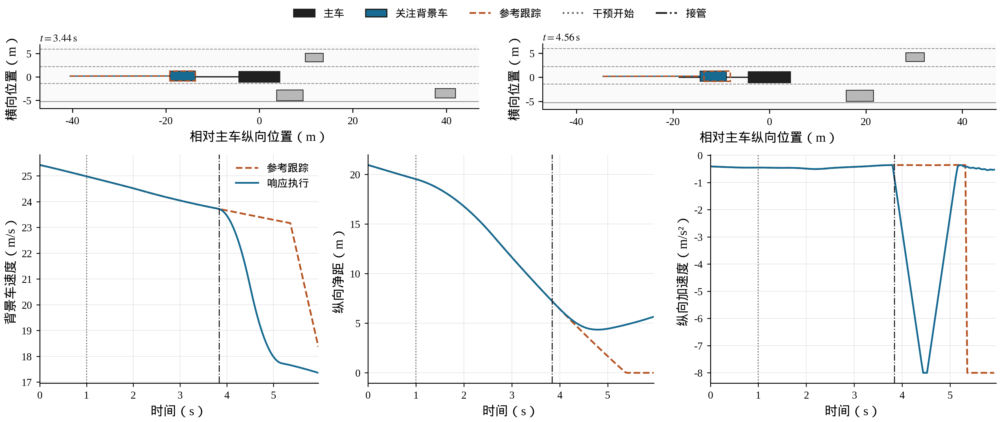
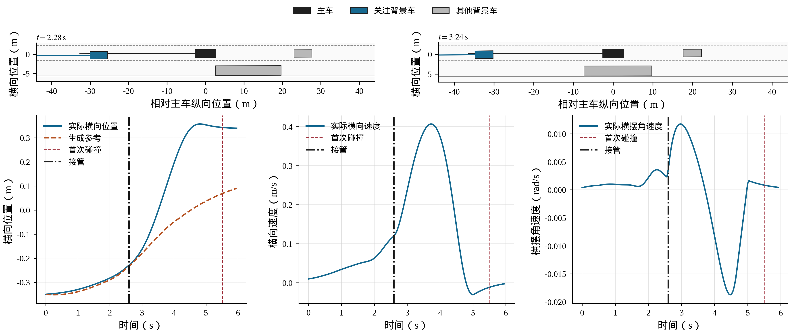

# 发明专利技术交底书

| 项目 | 内容 |
| --- | --- |
| 专利名称 | 一种面向多失效域的自动驾驶交互测试与修复方法 |
| 技术领域 | 自动驾驶仿真测试、生成式交通建模与驾驶模型修复 |
| 申请人 | 待填写 |
| 发明人 | 待依据实质贡献确认姓名及顺序 |
| 交底书撰写人 | 蒋拯民 |
| 技术联系人及联系方式 | 待填写 |
| 文稿日期 | 2026年10月25日；任务方法论修订稿 |

## 1 技术领域与所要解决的技术问题

本发明涉及自动驾驶系统（Autonomous Driving System，ADS）的仿真测试与模型修复，具体针对有限仿真预算下的自然长尾交互测试：从自然驾驶事件建立有数据依据的交通生成分布，在实际交通响应中发现当前ADS的分散失效，并将缺陷修正及成功回归的结果用于后续测试。方法以道路多车交互为实施对象，输出可执行测试实例、按区域组织的失效与成功记录、经验证接纳的驾驶模型以及下一轮测试安排。

该任务包含三个相互关联的问题。自然驾驶中风险较高的事件可以提供测试来源，但其稀有程度并不等同于某个ADS的失效条件；生成的周车运动需要保留原事件的交通意图，同时能够响应该ADS的实际动作。初始条件、运动意图和交互响应共同作用于失效，因而测试既需要自然风险基准，也需要在所生成世界中重新判定被测系统的结果。

在确定测试来源后，分散失效的发现仍受高维输入及有限预算制约。持续追逐全局最高风险容易使少数交互区域占据搜索与学习材料，而不同区域可能具有不同的风险尺度和变化方向。修复又会改变被测策略的失效条件：已有缺陷可以解除，原成功条件也可能转为失效。测试方法需要同时处理区域内的条件探索和策略更新后的区域变化，使下一次仿真具有明确的选择依据。

本发明所要解决的技术问题是：如何在自然尾部事件约束的响应式交通世界中，将分层生成分布、当前策略的失效条件及修复后的条件变化统一为可计算的测试方法，在有限执行预算下持续发现分散缺陷、取得有效修正材料，并将修复与回归反馈转化为后续测试分配。

本发明以分层生成确定输入分布，以实际交互执行确定失效集合，以分支条件采样推进缺陷发现，再通过相同输入下的新旧策略比较更新测试需求。世界生成及响应模型在修复周期内保持固定，搜索改变世界输入，修复改变ADS策略；前者的执行风险差用于调整区域内提议，后者的结果转移用于调整区域间分配。

## 2 技术背景与最接近的已有方案

与本发明直接相关的技术主要包括自动驾驶交互危险场景生成、分散失效测试，以及测试驱动的驾驶策略改进。World Engine将日志中的长尾发现、交互世界生成与驾驶模型后训练连接[1]；CAT通过交通先验、主车响应及碰撞关系的概率分解生成对抗场景，并与策略学习交替进行[2]；Evaluation as Evolution以扩散先验上的稀疏漂移控制构造边界案例，并随驾驶策略表现调整课程[3]。这些方案说明，生成与学习之间的反馈已是本任务中的有效技术路线。

在具体测试机制上，Safe-Sim通过扩散去噪中的对抗引导生成可控交互危险场景[4]；GUARD以安全、失效和未知区域的模型安排查询，并分析策略版本回归[5]。WO2025090341A1通过交通交互条件使仿真参与者选择性偏离记录轨迹[6]；KING将专家能够安全通过的危险场景用于驾驶模型微调[7]。本发明的分支组织采用生态位子集模拟的既有计算思想[8]，用于实现多区域条件探索。

本发明针对上述相同测试任务，进一步给出自然生成分布、区域条件探索及策略更新之间的计算关系。分层生成同时表达交通结构、长期意图和局部运动，响应式执行据实际行为定义失效；搜索在生成基础变量中构造分支条件分布，按前层执行差调整下一层提议并在层内固定；修复后重新判定旧端点，以当前区域内分别归一化的持续失效和成功回归安排后续执行。这些方法关系使自然事件扩充、失效发现及修复反馈共享同一个测试对象和判定基准。

因此，背景比较围绕本任务中的生成依据、条件探索对象、区域组织及策略更新反馈展开。第4节具体说明条件分布的构造、提议及接受规则，以及修复后经验转移量如何进入仿真调用。

## 3 发明构思与总体技术方案

本发明将长尾交互测试组织为自然尾部先验约束下的多区域条件探索，并通过策略更新持续修正测试重点。自然驾驶风险确定需要扩充的事件分布；归一化流和条件扩散把该分布表示为场景结构、初态、稀疏运动结点及结点间残差；交通响应将这些生成条件转换为随主车实际行为演化的联合执行。由此，生成模型确定测试来源，实际执行确定当前ADS在该来源下的失效条件。

分层表示承担不同的测试作用。初态与稀疏结点规定交通布局和中长期运动意图，给定结点的残差生成表达局部运动变化，驾驶及响应变量表达同一参考计划下的交互实现。软参考的结点约束与响应车辆的实际未来分别处理：前者保留所生成的交通意图，后者服从当前真实状态及交互条件。完整输入可以恢复，而实际轨迹随被测策略变化。

在上述生成先验中，各经验分支分别对应一个输入区域和逐级提高的风险条件。对连续基础变量使用先验可逆的分组扰动，对结构变量使用先验刷新；依据前层实际父子执行的风险变化确定下一层组概率及作用范围，并在该层内固定。提议经原生成映射及响应式仿真重新执行，由区域和阈值共同决定接受。该构造把分层生成空间转化为具有明确条件目标的测试空间，使不同区域能够分别向失效条件推进。

各区域取得的代表及真实成功邻点继续用于修复。监督式ADS使用在原失效输入下验证合格的联合纠正轨迹，强化学习ADS使用当前策略重新交互的经验；已有成功行为按其对应部署功能保持。候选通过隔离开发实例接纳后，对旧失效和旧成功恢复相同输入并重新执行，按当前分支分别计算持续失效及成功回归，再控制区域间分配。当前策略的条件样本重新生成，使测试始终对应其当前失效集合。

这形成两个相互配合的适应过程：在同一策略下，世界输入变化产生的风险差控制区域内如何提议；在相同世界输入下，策略更新产生的标签转移控制区域间如何分配。二者依次确定下一次仿真所属的分支和需要改变的变量组，将缺陷发现、修正学习及继续测试连接为可执行的方法。

**图1 长尾交互世界中的多失效域测试与修复总体框架（附图占位）**

由左至右绘制自然事件与风险尾部、Flow场景条件、扩散软参考、计划适用性与交通响应、分支条件搜索、修正学习、开发接纳及版本复测。输入分布经实际执行得到策略相关失效条件，复测反馈连接区域分配；区域内风险差连接分组提议。分别标明固定的世界生成及响应模型和接受更新的ADS策略。

## 4 技术方案的具体实施方式

### 4.1 自然驾驶尾部事件及分层场景条件

测试平台包括处理器、存储器、自然驾驶数据接口、交通仿真器及ADS训练接口。数据预处理统一车辆中心坐标、行驶方向、采样时标和车道语义，保留车辆尺寸、稳定身份、有效历史以及完整的换道前后过程。以一辆主车及其周围最多六辆背景车组成一个交互片段；背景槽位在片段起点确定，缺席车辆由占位标记表示。

根据实际尺寸、相对位置、速度和短时运动外推构建动态安全包络，计算主车与各背景车之间的包络侵入程度，并在车辆与预测时间上平滑汇总为非负瞬时风险。为同时反映峰值和暴露时长，将事件风险记为：

$$R(\tau)=\max_t r_t+\lambda_R\Delta t\sum_t r_t \qquad (1)$$

式（1）中，$\tau$为一段实际或自然驾驶联合轨迹，$r_t$为物理时刻$t$的瞬时风险，$\Delta t$为物理采样间隔，$\lambda_R$为具有相应时间倒数单位的预定暴露权重。动态包络的纵向尺度包含时距和制动余量，横向尺度包含横向接近及响应余量；与车身半尺寸共同确定侵入范围。逐时风险记录采用截至当前的峰值加累计暴露，不能将其解释为瞬时碰撞概率。

依据极值理论（Extreme Value Theory，EVT）在自然事件风险上采用超阈值建模，以阈值$u$以上的超额拟合广义帕累托分布。尾部生存函数及统一风险尺度为：

$$\overline F_R(r)=p_u\left(1+\kappa\frac{r-u}{\sigma_E}\right)^{-1/\kappa},\qquad S_E(r)=-\log\max\{\overline F_R(r),\epsilon\} \qquad (2)$$

式（2）适用于$r>u$且括号内为正的区域；$p_u$为自然样本超阈比例，$\kappa$与$\sigma_E$分别为形状和正尺度参数，$\epsilon$为防止对数溢出的正下界。形状参数趋于零时采用指数分布极限；阈值以下采用经验生存函数。阈值通过尾部拟合及稳定性检查确定，尾部事件用于后续分布建模。该尺度统一描述自然风险稀有程度，实际碰撞和越界仍由仿真执行单独判定。

对尾部事件提取六维背景占位$M$、26维初始条件$C_0$和36维稀疏位置结点$K$。初始条件包含主车初速及周车相对位置、速度；位置结点表示各背景车在预定未来时刻相对于自身初始位置的位移。归一化流（Normalizing Flow，Flow）在掩码条件下建模：

$$q_{\mathrm{tail}}(M,C_0,K)=p(M)\,p(C_0\mid M)\,p(K\mid C_0,M) \qquad (3)$$

式（3）中，$q_{\mathrm{tail}}$为场景条件建模层的尾部采样分布，$p(M)$为占位模式的经验概率，后两项分别由条件可逆流实现。可采用掩码自回归流，通过对数似然训练初态与结点模型；缺席槽位不产生有效运动目标。七辆车的尺寸数组$D$按占位模式从经验样本中抽取，尺寸不进入Flow损失。

解码后的初态按道路侧别、前后关系、速度限幅及车身间距进行物理投影；纵向结点按制动、加速可达位移范围依次投影。实际测试分布由基础变量经过生成与投影的完整映射确定。需要固定初态的实施方式可以调用条件结点接口；一般生成搜索允许初态随所选变量变化，但每个完成实例均保存其实际初态和生成输入。

### 4.2 条件扩散软参考及计划适用性响应

为使稀疏结点同时约束长期运动意图和局部轨迹变化，以保形分段三次插值（PCHIP）生成基准，再由条件扩散模型生成联合位置残差：

$$P=\mathcal I(C_0,K)+\mathcal R_{\Theta}(C_0,M,K;z_P) \qquad (4)$$

式（4）中，$P$为全部有效背景车的软参考计划，$\mathcal I$为穿过初始位置及稀疏结点的插值轨迹，$\mathcal R_{\Theta}$为已训练的条件残差生成器，$z_P$为扩散基础噪声，$\Theta$表示本轮固定的世界模型及执行参数。残差在结点处置零，使局部随机变化与给定结点相容。模型以自然Train片段的真实轨迹减去插值参考构造残差，完成标准化及去噪训练，再以确定的采样过程解码。该条件不包含主车未来动作或车辆尺寸；尺寸在物理执行和碰撞判定中使用。

稀疏结点和残差因此形成两种不同的场景操作：给定相同初态及结点时，改变扩散噪声仍保持软参考经过相同结点；改变结点流输入时，则重新确定中长期位移并生成与之相容的残差。该约束施加于生成的软参考。进入实际交互后，响应车辆从当前状态继续驾驶，其实际未来由交通演化决定，使结点约束的生成意图与主车行为引起的响应能够在同一世界中共同表达。

跟踪器依据软参考的位置、速度及加速度，采用前馈和位置、速度反馈生成纵向控制，依据参考偏航率、航向与位置反馈生成横向控制，再由统一动力学执行。每个物理步评估计划适用性：对尚未进入响应控制的背景车，使用剩余参考并校正当前跟踪偏差；对主车及已实际响应的车辆，使用当前状态与因果历史外推。短时预测不读取主车未来控制。

为保留误差的时间相关性，从自然数据建立完整的短时预测误差轨迹库。每条误差轨迹同时保存纵向、横向及航向偏差；按运动状态选取成组样本，分别叠加到候选车辆对的基准预测。在每组完整预测中检查整个时域是否出现有向车身相交，以样本支持度表示该项证据：

$$q_{ij}(t)=\frac{1}{N_E}\sum_{\ell=1}^{N_E}\mathbf 1\left\{\min_{s\in\mathcal T_t}d_{ij}^{(\ell)}(s)\leq0\right\} \qquad (5)$$

式（5）中，$i,j$为车辆索引，$\mathcal T_t$为当前时刻后的短时预测区间，$N_E$为成组完整误差实现数量，$d_{ij}^{(\ell)}(s)$为第$\ell$组实现中两车在时刻$s$的有向矩形分离量，$\mathbf 1$为条件成立时取1的指示函数。矩形相交对应非正分离量；车辆前后关系及主动换道关系决定需检查的方向。本实施例取16组及支持度门限1/16，该支持度是经验触发证据。

计划适用性同时检查非碰撞交互变化。已建立的近处领车加速而本车继续原计划会明显扩大间距时，计算跟驰条件变化分数；原领车离开本车通道且原计划尚未安排对应响应时，计算通道释放分数。两项按Train尺度归一化后与预定门限比较，避免把无关邻车离开误判为本车通道释放。

用二值状态$b_i(t)$表示第$i$辆背景车是否已经交由响应策略控制：

$$b_i(t+1)=b_i(t)\lor A_i(t) \qquad (6)$$

式（6）中，$A_i(t)$为占用冲突、跟驰条件变化、通道释放或参考到期中任一预定接管条件成立的标志，$\lor$表示逻辑或。尚未接管时执行参考跟踪，接管后由该车辆的驾驶策略控制至回合结束。交接承接实际位置、速度、历史、上一动作、驾驶特征及已开始机动；正在换道的车辆从当前运动状态继续面向原目标车道生成剩余运动，不从换道起点重新执行。

控制器还将“已取得控制权”与“已实际执行偏离参考的控制”分别保存。每个物理步把上一时段实际执行的背景动作与经过相同执行限幅处理的参考跟踪动作比较；只有存在超出预定数值容差的差异，才置位实际响应标志。在对其他车辆预测时，尚未实际执行偏离控制的车辆继续提供经当前偏差校正的参考；已实际响应的车辆改用实际历史外推。因而，交接决定首先落实为真实控制，其后果再进入其他车辆的适用性判断，避免仅由控制权标签改变就产生虚构的响应传播。

背景响应可采用经自然数据标定的智能驾驶员模型（IDM）、MOBIL换道规则及条件换道轨迹。桥接层决定原计划何时不再适用，响应策略决定具体如何驾驶。两者共用车身几何、真实领车净间距和并排、切入关系，并将驾驶及动作扰动按稳定车辆身份与绝对物理时标索引。桥接门限依据自然保持及响应要求确定，不以减少被测ADS事故数作为优化目标。

**图2 分层生成与状态承接的交互执行结构（附图占位）**

绘制占位与尺寸采样、初态Flow、结点Flow、PCHIP和扩散残差，以及软参考跟踪、适用性判断和背景响应。适用性输入区分剩余计划与因果历史，接管箭头标注实际状态、机动目标和绝对时标；分别画出控制权标志与实际响应标志，后者连接其他车辆预测的来源选择；接管后箭头不返回参考跟踪。

下列既有工程实例用于说明上述交互执行。在相同脚本制动条件下，响应臂与纯跟踪臂采用相同起点，展示主车行为变化怎样进入周车控制。该图用于说明交通响应机制。

**图3 主车制动后的背景车辆响应（已有工程实例）**

另一既有实例在2.60秒交接时记录到换道已经开始，归一化进度约0.854。实际位置、速度与控制记录用于说明交接从已发生的机动继续；图中保留回合后续碰撞时刻，响应执行的合理性与主车能否避免事故分别判断。

**图4 已开始换道的接管与机动承接（已有工程实例）**

### 4.3 可恢复生成输入与多分支风险搜索

将世界采样所需输入明确保存为八类基础随机变量$\omega$：场景结构均匀变量、初态流变量、结点流变量、软参考扩散噪声、驾驶特征变量、机动特征变量、逐车逐时响应扰动及标定扰动。除结构变量外，可采用独立标准高斯数组；结构均匀变量通过经验分布的累计概率确定占位及条件尺寸样本。实际使用的标定扰动位置按既有执行接口限定。

将道路、初态、有效性、尺寸、软参考及相应外生变量组成完整实例$I$。生成与执行关系表示为：

$$I=G_{\Theta}(\omega),\qquad \tau_{\pi}=S_{\Theta}(I;\pi) \qquad (7)$$

式（7）中，$G_{\Theta}$为固定世界的实例化映射，$S_{\Theta}$为包含参考跟踪、交通响应及动力学的闭环执行映射，$\pi$为当前被测策略，$\tau_{\pi}$为实际联合轨迹。以$\mu$表示基础变量的联合先验，由结构均匀分布与各高斯组的独立先验组成；经式（7）生成的轨迹分布同时取决于固定世界和被测策略。ADS自身的采样随机上下文按预定规则控制，以下映射及结果均在对应上下文给定时计算。实例记录独立采样祖先、父代、扰动组和生成资产。

其中，驾驶和响应扰动直接保存为可索引数组，逐车逐时元素在不同控制分支中仍对应相同物理时刻。重测时同时恢复生成输入、实例内容及世界资产；车辆是否接管、主车是否提前制动可以改变其实际演化，但不会使另一时刻的随机元素被错当成当前输入。该输入对应关系也用于专家纠正验证，使不同主车行为接受同一外生条件下的交互检验。

初始搜索从世界先验独立采样，在实际轨迹上分别记录碰撞、道路越界、停车和风险。令$F_{\pi}(\omega)$表示碰撞或越界这一安全失效标志；用于条件层推进的分数为：

$$H_{\pi}(\omega)=F_{\pi}(\omega)+\bigl(1-F_{\pi}(\omega)\bigr)\frac{R(\tau_{\pi})}{1+R(\tau_{\pi})} \qquad (8)$$

式（8）中，失效样本统一进入取值为1的终层，未失效样本按原始风险排序并保持小于1。停车另作任务资格判断。极值风险尺度继续描述自然事件的稀有程度，ADS真实失效依据其实际执行单独确定。尾部标定确定测试来源，实际执行确定搜索目标，两者在方法中承担不同作用。

以$\mathcal F_{\pi}=\{\omega:F_{\pi}(\omega)=1\}$表示当前策略在该世界中的失效集合。为在不同区域分别向该集合推进，将当前分支的输入区域记为$\mathcal B_b$、当前层阈值记为$c_b$，相应条件采样目标为：

$$\mu_{\pi,b}(d\omega)=\frac{\mathbf 1\{\omega\in\mathcal B_b\}\,\mathbf 1\{H_{\pi}(\omega)\geq c_b\}}{Z_{\pi,b}}\mu(d\omega) \qquad (9)$$

式（9）中，$b$为搜索分支索引，$Z_{\pi,b}$为分子指示条件在先验$\mu$下的积分，取正时定义该条件分布；$\mu_{\pi,b}$表示在当前分支及阈值下对基础输入条件化后的分布。不同分支分别提高阈值，使探索方向对应各自的风险区域；阈值达到1时对应实际安全失效条件。区域和阈值确定后，以下提议用于该层的条件探索。

对高斯变量组采用先验保持的预条件Crank–Nicolson提议，简称pCN提议：

$$z_g'=\sqrt{1-\rho^2}\,z_g+\rho\varepsilon_g,\qquad \varepsilon_g\sim\mathcal N(0,I_g) \qquad (10)$$

式（10）中，$g$为变量组，$z_g$及$z_g'$为当前与提议值，$\rho$为大于0且不大于1的提议尺度，$\varepsilon_g$为同维独立标准高斯创新，$I_g$为相应单位协方差矩阵。结构均匀变量采用独立均匀刷新。改变Flow或扩散输入后，经原生成器重新形成完整场景，不能直接在物理轨迹间插值替代生成。

各分支分别按自身分位数提高条件阈值，并维持独立条件链。提议满足本分支当前阈值及划分条件时接受，否则保留原链状态。为使变量选择与生成结构对应，保留正比例的联合提议，其余提议选择一个变量组；由上一层已执行父子样本的归一化风险变化更新组敏感度，以组敏感度与正基础权重之和归一化得到组选择概率。相关车辆和响应时段取自上一层实际关键车辆及关键时刻，并在新层开始前与组概率共同固定。联合提议不混入单组敏感度统计。

一种敏感度更新采用：

$$s_{b,g}\leftarrow(1-\nu)s_{b,g}+\nu\,\operatorname{mean}\frac{|R(\tau_{\pi}')-R(\tau_{\pi})|}{1+|R(\tau_{\pi})|} \qquad (11)$$

式（11）中，$s_{b,g}$为分支对第$g$组的敏感度，$\nu$为大于0且不大于1的平滑系数，$\tau_{\pi}'$为同一策略在提议输入下的实际轨迹，均值取已实际执行的单组父子样本；比例可加预定上界。各组敏感度以相同正值初始化，本实施例取1。敏感度表征执行风险对该类生成变量的变化，不作为某组变量的因果贡献估计。

将当前分支可用的变量组集合记为$\mathcal G_b$，单组提议的选择概率可按下式确定：

$$p_{b,g}=\frac{\delta+s_{b,g}}{\sum_{h\in\mathcal G_b}(\delta+s_{b,h})},\qquad g\in\mathcal G_b \qquad (12)$$

式（12）中，$\delta$为正基础权重，$h$为求和用的变量组索引。没有有效背景车辆或没有可用响应时段时，按当前层既定规则排除相应空组；其余组仍保留正选择概率。一种配置取基础权重0.05，并以0.2的比例使用联合提议。单组比例、车辆掩码及响应时段均在本层执行前固定，层内不随某个候选的即时结果改变。

将固定作用坐标后的单组提议核记为$\mathcal K_{b,g}$，全部组的联合提议核记为$\mathcal K_b^{\mathrm J}$，本层混合提议为：

$$\mathcal K_b=\gamma\mathcal K_b^{\mathrm J}+(1-\gamma)\sum_{g\in\mathcal G_b}p_{b,g}\mathcal K_{b,g} \qquad (13)$$

式（13）中，$\gamma$为大于0且小于1的预定联合提议比例，$\mathcal K_b$表示给定当前输入时产生候选输入的转移核。pCN作用于固定高斯坐标，均匀刷新作用于结构坐标，各组均对其基础先验可逆；联合核对不同组依次操作，组间先验独立。层内固定的混合权重和作用坐标使$\mathcal K_b$同样对$\mu$可逆。

候选经完整生成和交互执行后，按下式决定是否接受：

$$a_b(\omega,\omega')=\mathbf 1\{H_{\pi}(\omega')\geq c_b\}\,\mathbf 1\{\omega'\in\mathcal B_b\} \qquad (14)$$

式（14）中，$\omega'$为提议基础变量，$a_b$取1时接受、取0时保持原链状态。设$\mathcal K_b^{\mathrm A}$为该接受与拒绝规则形成的实际转移核，在当前层配置固定、条件集合具有正先验质量及提议对先验可逆的条件下，有$\mu_{\pi,b}\mathcal K_b^{\mathrm A}=\mu_{\pi,b}$。其依据是：条件集合内部的转移继承先验详细平衡，离开条件集合的提议质量保留在原状态，因而保持式（9）的条件目标。

这说明层间适应与层内固定具有明确的方法作用：前层风险差可以改变下一层选组及作用范围，同时本层仍按给定条件目标执行接受判断。生成及物理投影统一包含在实例映射中，即使投影使多个基础输入对应同一物理场景，条件探索仍在已知基础先验中定义；接受判断不需要计算投影后场景的显式密度或归一化常数，也不需要对ADS或整个交通仿真求导。有限自适应搜索样本的命中比例用于评价发现效率。

分支划分选取来源及条件链较分散的少量代表，对代表之间的基础随机坐标中点重新实例化并闭环执行。中点分数不低于两端较低分数时建立性能关系边，再由社区划分及输入分类器形成候选分支。该处理采用已有生态位子集模拟的分支思想，将判别查询落实到完整交互世界。查询预算不足时保留“关系未知”，不据未检查关系宣布分离；单个孤立点保存为候选。

本交底书所称“多失效域”指面向不同失效区域进行分支搜索与组织。实施中通过有限性能关系检查形成经验搜索分支；分支、采样祖先和碰撞输入分别作为搜索组织、来源及结果的计数对象。

### 4.4 分支档案、成功邻点及修复反馈

在每个分支中，先保留高风险失效，再按照归一化交互描述的最远点原则选择差异较大的代表，设置分支容量及同一祖先的代表上限。交互描述来自实际最危险时刻、相对运动和接管理由，用于域内分散选样，不预先决定失效类别或分支数量。

若实际执行过的单组父子实例具有相同占位结构且安全结果相反，则保存失效实例及其成功邻点，记录两者完整输入和提议关系。此处成功邻点表示相对于安全失效判据的非失效端点，进入保持材料前还需核对完整执行及未停车资格。单组父子关系约束被扰动的基础变量组，实际初态可随所选组变化；邻点用于说明已执行两端的局部结果差异及后续回归检查。没有实际成功邻点时保持为空。

修复取材按分支轮转并在选取失效代表时去除重复祖先，使不同搜索区域能够提供学习材料；相应成功邻点可以进入保持材料。失效标签绑定实际执行策略版本，不能凭历史标签把一个旧实例继续当作当前缺陷。

在已接纳策略更新后，恢复旧档案中选定端点的相同实例、世界资产和外生输入，重新执行。背景车辆依据新主车行为响应，所以比较保持的是输入条件；实际主车、周车轨迹均可改变。已重测旧失效仍失效的记录形成持续失效需求，已重测旧成功转为失效的记录形成回归需求。

将接纳的新策略记为$\pi_{\mathrm n}$。其失效集合$\mathcal F_{\pi_{\mathrm n}}$由新执行重新确定，旧失效可以解除，旧成功也可以进入该集合。新一轮从独立先验建立当前策略的搜索树，将已重测端点按当前分支划分归属。以$\mathcal E_b^{\mathrm f}$及$\mathcal E_b^{\mathrm s}$分别表示落入当前分支且已重测的旧失效、旧成功输入集合，计算：

$$u_b=\frac{1}{|\mathcal E_b^{\mathrm f}|}\sum_{\omega\in\mathcal E_b^{\mathrm f}}F_{\pi_{\mathrm n}}(\omega),\qquad v_b=\frac{1}{|\mathcal E_b^{\mathrm s}|}\sum_{\omega\in\mathcal E_b^{\mathrm s}}F_{\pi_{\mathrm n}}(\omega) \qquad (15)$$

式（15）中，$u_b$为持续失效的经验比例，$v_b$为成功回归的经验比例，竖线表示集合中的已重测输入数量；任一分母为零时相应项取零并记录反馈范围。两项分别归一化，使旧失效和旧成功的数量差异不直接决定各自权重，所用比例描述档案端点的实际转移。根据该结果构造分支反馈权重：

$$w_b=1+u_b+2v_b \qquad (16)$$

式（16）中，系数1为基础探索权重，持续失效及成功回归的系数分别取1与2；两类反馈系数可在测试前配置。该权重用于分配执行预算，反馈样本范围同时保存。

设$n_b$为当前分支已分配的提议执行数，在活跃分支中优先选择$n_b/w_b$较小者，形成加权公平分配。敏感度决定选定分支内主要改变哪类输入，反馈权重决定优先在哪个分支继续执行。旧分支与新分支通过重测端点的成员关系记录延续、分裂或合并；旧条件粒子不直接作为新策略的条件样本，保留的新先验抽样用于发现旧档案之外的失效。

两个调整环节分别使用不同的比较记录。组敏感度比较同一策略下的父子输入，并在下一层改变组选择；分支权重比较相同完整输入在新旧策略下的安全标签，并在当前分支中确定执行优先级。先选择分支再选择该分支的输入组，最终产生一次具体的仿真调用。基础权重和独立先验抽样为尚无历史端点的区域保留探索机会。

例如，在同一当前搜索子树内，来自同一旧分支的重测端点分布在两个当前分支时，按其当前成员关系分别计算持续失效与成功回归，而不把旧分支的整体比例直接复制给两个分支。若部分旧成功端点转为失效，其需求通过对应当前分支的回归项进入优先级；该端点在材料入口还会按当前结果判断需纠正还是可保持。

**图5 生成变量、搜索分支与修复后复测的关系（附图占位）**

上部绘制八类输入经生成器成为实例和实际结果；中部绘制分支内阈值推进、代表与成功邻点；下部绘制同输入新策略复测、旧端点映射到当前分支、两类反馈及公平选择。风险差箭头连接组敏感度，版本结果变化箭头连接分支权重，二者分别标识。

### 4.5 从执行证据到原生修复目标

对需要修正的失效实例，从相同完整初态及外生输入验证另一主车控制行为，允许周车正常响应。可采用目标车道、目标速度和机动时序的有限候选表，先粗搜索再细化。仅对完整执行、无主车碰撞、无越界且未停车的候选生成正向纠正材料；多个候选合格时，优先选择对原行驶意图改动较小者，再比较平顺性与任务表现。候选额度内没有合格结果时，保留缺陷状态。

纠正主车未来及周车未来共同取自该次成功执行，观测由相应决策时刻及过去历史构造。成功邻点或当前策略原本成功的实例保留其策略版本和因果观测，用于保持已有效的行为；成功邻点不替代原失效自身的纠正验证。原任务人类数据继续提供其原生监督。由此区分纠正材料、成功保持材料及原任务材料，并使来源标记进入学习计算。

在监督规划器中，以$L_C$表示纠正监督，以$L_N$表示原任务监督，以$L_0$及$L_S$分别表示对最初部署模型和近期成功策略的功能保持，组合目标为：

$$L=L_C+\lambda_NL_N+\lambda_0L_0+\lambda_SL_S \qquad (17)$$

式（17）中，$\lambda_N,\lambda_0,\lambda_S$为由预定抽样比例及损失系数共同确定的非负权重。样本先按独立场景或采样祖先选择，再取决策时刻，避免密集帧放大单一事故的训练权重。本轮没有新的合格纠正材料时，监督修复保留原策略并记录材料状态。教师仅参与训练目标计算，最终由一份学生模型执行推断。

对采用固定未来表示的扩散规划器，按其原坐标、参考点及状态归一化转换联合轨迹$Y$，一种实现以主车后轴局部坐标表示位置及航向角正余弦。以$V$表示真实未来有效性掩码：车辆有效且未来时刻位于实际执行范围内时取1，否则取0；这与场景占位$M$是不同对象。干净内容处理与加噪为：

$$\overline Y=V\odot Y,\qquad Z_{\eta}=\alpha(\eta)\overline Y+\sigma(\eta)\xi \qquad (18)$$

式（18）中，$\odot$表示广播逐元素乘法，$\eta$为扩散时刻，$\alpha,\sigma$为原生加噪系数，$\xi$为完整固定窗口的标准高斯噪声。无效干净位置在归一化后再次置零；对当前存在车辆的未知未来，保留带噪输入中的噪声分量，仅屏蔽相应输出误差。当前缺席车辆按规划器原接口处理。

以$F_{\theta}(o,Z_{\eta},\eta)$表示学生在观测$o$及给定扩散输入上的原生去噪输出，$\theta$为其参数。在干净轨迹预测参数化下，纠正材料集合$D_C$的目标为：

$$L_C=\mathbb E_{D_C,\eta,\xi}\left\|F_{\theta}(o,Z_{\eta},\eta)-\overline Y\right\|_V^2 \qquad (19)$$

式（19）中，$\|\cdot\|_V^2$表示在有效未来位置求平方误差均值；一种实现对主车及周车分别求均值后相加，空有效集合取零。原任务按有效人类标签计算对应监督。采用其他原生去噪参数化时，使用其实际目标。

对策略成功材料集合$D_S$，以产生成功执行的部署版本$\theta_r$作为冻结参照：

$$L_S=\mathbb E_{D_S,\eta,\xi}\left\|F_{\theta}(o,Z_{\eta},\eta)-F_{\theta_r}(o,Z_{\eta},\eta)\right\|_V^2 \qquad (20)$$

式（20）中，教师与学生接收相同观测、带噪轨迹和扩散时刻。教师无梯度，学生保留梯度，比较期间关闭干扰输出差的随机层。成功记录的物理未来用于带噪内容及有效范围，学习目标则取自对应去噪器；实际运动包含跟踪与滚动重规划，不能直接将其等同于规划器单次输出。对最初正常能力采用固定原模型参照，对近期接纳策略的新成功采用相应部署版本参照。

对于采用近端策略优化（PPO）的强化学习ADS，失效实例用于环境重置，由当前策略重新交互取得动作、回报及价值目标；旧执行轨迹和专家轨迹不作为当前策略经验。原任务及成功观测进入冻结教师约束，例如在连续动作Beta分布上计算具有学生梯度的相对熵。该学习路线与监督纠正共享世界实例、成功保持及开发接纳接口，具体训练目标按ADS原算法确定。

参数更新在原网络内划分冻结与可训练部分，并固定归一化统计。监督实施例更新末部去噪块及输出层，强化学习实施例更新策略及价值输出相关模块；候选验证使用实际部署参数。采用指数滑动平均时，仅对可训练浮点参数维护平均，并保存与训练参数及优化器状态的对应关系。

**图6 执行来源、算法原生目标与候选验证（附图占位）**

将合格纠正、策略成功和原任务示范分别连接监督或功能保持目标；另绘制强化学习实例重置及当前策略采集。扩散子图标明实际未来掩码和完整窗口噪声。各路汇合到局部参数更新、部署参数、闭环开发验证及接纳或恢复。

### 4.6 候选接纳、继续测试与输出

在修复前隔离开发实例，将候选、最初部署模型和上一接纳模型置于相同完整输入及对应策略随机上下文下执行。分别检查碰撞、越界、停车、任务进度以及已成功端点的新增失效。一种配置要求长尾生成及自然生成开发集合上的安全计数均不增加、总进度不少于相应参考的98%，并要求长尾碰撞减少，或者档案中存在失效解除且无新增失效；该两种改善条件按预先规则择一成立。多候选通过时按预定排序选择。

接纳后导出同一部署参数，并将新策略版本绑定到随后执行结果；未通过时恢复最近接纳版本的训练参数、部署滑动平均及优化器状态。通过开发规则表示该预定集合上的候选合格，最终留出实例用于独立评价，不参与标签构造或选择。

下一轮依第4.4节恢复端点并重新建树。单分支可因达到条件层上限、完成终层提议或取得足额代表而结束；整轮按实际执行预算或预定任务完成条件停止。首次发现碰撞不使整轮自动结束，达到搜索深度上限也不判定该区域安全。实际调用总账包含独立采样、接受与拒绝提议、分支查询及轮首重测；专家候选和训练交互另行记录。

最终交付包括固定世界参数及实例、分支与来源谱系、纠正和保持材料、接纳的ADS参数及其开发验证记录。调整的是世界输入搜索及驾驶模型，尾部标定、生成模型和响应参数在该次迭代期间保持固定，从而使同输入版本比较具有明确参照。

## 5 核心技术方法、协同作用与保护重点

本发明的整体构思是，在自然尾部事件所确定的交通生成依据下，对当前ADS的失效条件进行分区域探索，并利用修复后的条件变化继续安排测试。其核心由以下三项相互依赖的方法关系构成。

分层响应式测试分布构造。自然风险尾部确定来源事件，占位、初态及稀疏结点的条件分解确定场景变化，结点约束残差表达局部运动，计划适用性将参考转换为实际交互。测试分布由输入先验、固定生成映射及被测策略下的响应执行共同决定。该方法使交通意图的条件生成与主车行为引起的实际响应能够共同用于失效判定。

生成先验中的多区域条件探索。各分支分别定义区域及风险阈值，组敏感度调节区域内的提议方向，基础先验可逆提议与层内固定配置共同支持分支条件采样。即使生成包含非一一对应的物理投影，仍能在基础空间中定义条件目标并执行接受判断，无须求取投影后场景密度。层间适应改变下一层探索配置，区域和阈值接受规则保持当前层的条件目标；分支来源限制及代表选择使取得的材料分散于不同实际交互。

面向策略变化的测试与修复反馈。相同世界输入下，新策略重新产生实际联合轨迹及安全标签；在当前分支中分别归一化持续失效与成功回归，避免两类端点数量差异直接支配反馈。该经验转移量控制区域间执行分配，同策略的父子风险差则控制区域内选组。合格纠正和成功功能保持按各自执行来源进入原生学习，使模型修复改变下一轮测试所针对的实际失效集合。

| 核心方法 | 必要的操作关系 | 技术作用及实施支撑 |
| --- | --- | --- |
| 分层响应式测试分布 | 尾部事件条件建模；结点与残差分层；按参考适用性从实际状态响应 | 生成意图与实际交互共同定义测试对象；第4.1至4.2节 |
| 分支条件探索 | 基础先验可逆提议；前层风险差决定本层固定配置；区域及阈值共同接受 | 给出明确的条件采样目标并分别推进分散区域；第4.3节 |
| 策略变化反馈 | 同输入复测；当前分支的两类经验转移；区域间分配与区域内选组 | 把修复与回归转为下一次实际测试；第4.4至4.6节 |

上述方法以同一完整输入贯穿生成、搜索、纠正验证及版本比较。EVT、Flow、扩散、子集模拟和功能保持的已有原理分别提供实现工具，拟保护的技术内容是它们在本测试任务中的对象分解、条件约束及反馈计算关系。具体参数、控制状态标志、外生输入索引、未来掩码及检查点恢复作为实施细节或从属限定，支撑方法执行。

对应系统包括风险与场景建模、世界实例化、交互执行、分支搜索与档案、修正学习和候选验证模块。处理器依据条件采样及版本反馈结果调用交通仿真和模型训练接口；替代模型应保持上述输入、条件判断及反馈作用关系。

## 6 工程实施与已有验证依据

项目已有自然驾驶数据、概率生成、交互执行、搜索和ADS修复的完整工程链。自然片段含150个状态及149次物理转移，步长0.04秒；背景软参考覆盖5.96秒。所接入主车扩散规划器预测80个未来位置，间隔0.1秒，其8秒时域长于事件窗口，真实未来有效性因而直接参与目标构造。下面按各证据实际验证的对象说明，而不将模块重建结果代替ADS闭环结果。

自然事件处理对96,055个片段统一标定风险尾部，取得2,964个尾部事件；该数量用于定义Flow拟合来源。Flow使用占位、初态和稀疏结点分解，尺寸另作经验采样。在目标尾部分布拟合检查中，256投影方向的切片Wasserstein距离为0.0615，所比较的Gaussian及八分量GMM分别为0.1332与0.1046；该结果说明本实施例对目标条件分布的拟合情况。

背景轨迹模型在完整自然Test的10,151个场景上评估，其中9,841个具有有效背景车目标，每个条件采样16次，单次样本平均位移误差约0.0527米。该评估给定真实稀疏结点，验证结点之间的条件重建；生成测试使用Flow采样结点，两者的条件来源分别记录。

交互桥接的自然回放覆盖10,151个场景，三个随机实现各有7个场景触发接管；另有51个预选脚本干预案例、合计204回合，用于验证制动、跟驰变化、通道释放及机动承接。制动类包含9个案例的27个响应回合，其中15个配对回合解除纯跟踪时的碰撞，没有新增配对碰撞；15个回合包含相同案例的不同随机实现。该受控记录直接支持在主车制动后调整失去适用性的参考，属于交通响应验证。CPU测试的8,493个物理步中，世界更新P99最大约8.59毫秒，未出现超过40毫秒物理步长的记录；该计时不包含ADS计算。

首轮ADS发现比较采用相同初始Diffusion Planner及每方法5,000次实际调用。随机抽样、普通子集搜索与本实施例引导搜索的主搜索去重碰撞输入分别为160、215与450；排除初态碰撞后分别为158、212与449。本实施例的450项来自98个独立采样祖先，分支诊断的500次调用已计入总预算，其中19次碰撞不混入450项。结果支持定向发现效率，碰撞输入数不解释为独立失效域数量或先验事故概率。

引导搜索首轮档案保留106个失效代表和9个成功邻点；修复材料实际包含27个专家来源及37个策略成功来源。下一轮对115个旧端点在新策略下重测，106个旧失效中43个解除、63个持续，9个旧成功中1个回归、8个保持成功。这些记录说明两类反馈在实际流程中均有处理对象，当前调度按端点在当前分支中的归属计算。

开发准入接纳了500次更新候选：在两组各500个开发实例上，长尾生成与自然生成碰撞分别由20、10变为15、9；1,000次更新候选的对应计数为50、27，未被接纳。最终同一接纳模型在2,000个冻结长尾生成实例上的碰撞由61变为40。该结果属于搜索、材料、学习与准入的整体效果。在两组各2,000个实例的自然记录回放和自然生成评价上，碰撞计数分别为76→80和41→37。第二轮新候选未通过开发准入，最终仍保留首轮接纳参数。

本实施例可替换条件流结构、残差生成器、驾驶响应模型或ADS学习算法，但应保留分层输入与完整实例的对应、基于实际行为的交通响应、分支组织及修复后同输入复测。已实现的强化学习接口提供另一种修复实施方式；当前量化整体效果以已完成的Diffusion Planner试验为依据。生成式世界的扩散模型与被修复的扩散规划器是不同对象，前者生成背景参考，后者输出主车计划。

## 7 附图说明与参考文献

图1表示总体框架，图2表示分层生成及响应交接，图3与图4为已有脚本干预工程实例，图5表示分支搜索及修复反馈，图6表示原生学习和候选验证。图1、图2、图5、图6保留附图占位，后续绘制中文黑白逻辑图；图3、图4直接使用已有PNG，不另行仿真或补画结果。

[1] Li T, Chen L, Wang C, et al. World Engine: Towards the Era of Post-Training for Autonomous Driving. arXiv:2606.19836v1，2026-06-18。https://arxiv.org/html/2606.19836v1

[2] Zhang L, Peng Z, Li Q, Zhou B. CAT: Closed-loop Adversarial Training for Safe End-to-End Driving. CoRL，2023；arXiv:2310.12432v1，2023-10-19。https://arxiv.org/html/2310.12432

[3] Guo Y, Liu J, Xu C, et al. Evaluation as Evolution: Transforming Adversarial Diffusion into Closed-Loop Curricula for Autonomous Vehicles. arXiv:2604.07378v1，2026-04-08。https://arxiv.org/html/2604.07378v1

[4] Chang W J, Pittaluga F, Tomizuka M, et al. Safe-Sim: Safety-Critical Closed-Loop Traffic Simulation with Diffusion-Controllable Adversaries. arXiv:2401.00391，核对2024-08-06的v3。https://arxiv.org/html/2401.00391

[5] Tu J, Suo S, Zhang C, et al. Towards Scalable Coverage-Based Testing of Autonomous Vehicles. CoRL，2023。https://waabi.ai/research/guard

[6] Mendoza J P, Unnikrishnan R, Wahal S, et al. Selectively intelligent actors in simulations. WO2025090341A1，2025-05-01公开。https://patents.google.com/patent/WO2025090341A1/en

[7] Hanselmann N, Renz K, Chitta K, et al. KING: Generating Safety-Critical Driving Scenarios for Robust Imitation via Kinematics Gradients. ECCV，2022。https://arxiv.org/html/2204.13683

[8] Kinnear H J, DiazDelaO F A. Niching subset simulation. Probabilistic Engineering Mechanics，2025，79：103729。https://discovery.ucl.ac.uk/id/eprint/10204007/

**摘要建议稿**

本发明公开一种面向多失效域的自动驾驶交互测试与修复方法。由自然驾驶尾部事件建立条件分布，通过初态、稀疏结点及条件残差生成多车软参考，按计划适用性从实际状态执行交通响应。在分层生成及响应的基础变量中构造分支条件采样，依据前层执行风险差调整并固定本层提议配置，以区域和阈值共同决定接受，取得来源分散的失效与成功端点。按执行来源开展模型修复与功能保持；候选接纳后，在固定世界及相同输入下复测旧端点，按当前分支分别计算持续失效和成功回归，进而控制区域间分配及区域内探索，实现面向策略变化的长尾交互测试与修复反馈。
